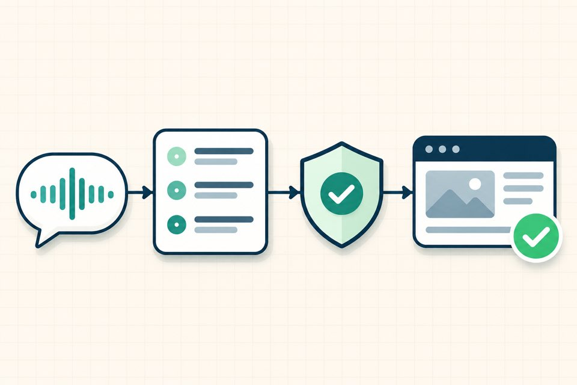
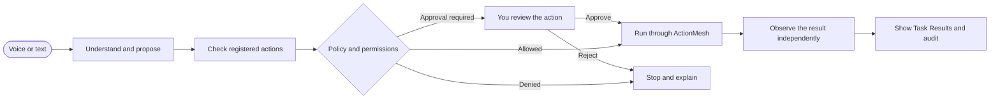

<div align="center">


# ActionMesh + VoiceOS

### A voice-first assistant for real desktop work.

Speak or type a request. Follow the task as it runs. See what was verified, what needs approval, and what could not be done.

<br>


[](https://github.com/abhijeetmiskin1/ActionMesh/actions/workflows/ci.yml)

<br>

[⚡ Quick demo](#quick-demo) · [📁 Projects and goals](#projects-and-goal-contracts) · [🧪 Continuum Lab](#continuum-lab-v5) · [🌐 ParallelWorld](#parallelworld) · [🎬 Demo scripts](docs/DEMO_RUN_OF_SHOW.md) · [🧭 How it works](#from-request-to-result) · [✅ Capabilities](#capabilities) · [🗺️ Roadmap](#roadmap) · [🛠️ Setup](#run-locally)

</div>

---

## Built around a simple promise

ActionMesh is the control layer. VoiceOS is the desktop interface. Together, they turn supported requests into observable tasks with clear permission checks and results.

<div align="center">

<br><sub>Concept illustration · the desktop interface and available actions depend on your setup</sub>
</div>

## ⚡ Quick demo

Open **Voice Commands**, press the microphone, and try these. For a quiet room, type the same words and click **Send & run**.

| Try saying | Expected behavior |
|---|---|
| **“Open Calculator, then is Calculator running?”** | Opens Calculator, then checks its running state independently. |
| **“Open WhatsApp”** | Requests the native launch using the app permission. WhatsApp must be installed on the Mac. |
| **“Open browser”** | Opens a page in the controlled browser and reports the observed navigation. |
| **“Check the best deal”** → **“USB-C charger”** | Asks for the product, then opens search links. These are discovery links, not verified offers. |
| **“Show open issues in abhijeetmiskin1/ActionMesh”** | Looks up public repository issues and returns a source-linked result. |
| **Compare workspace files** | In a configured workspace, compares two supported files and reports a verified match/difference result without displaying their contents. |

In **Task Results**, check whether each step succeeded, failed, needs approval, or could not be verified. Enable **Keep listening after replies** to try **“Jarvis, repeat that”** and **“Jarvis, stop listening.”**

## 📁 Projects and Goal Contracts

The **Projects** workspace registers local folders beneath the configured workspace root, detects Git repositories, selects a project, and displays its real path and inspection result. You can register loopback HTTP services against a project with a structured executable, arguments, working directory, port, health path, expected status, and timeout.

Goal Contracts are stored separately per project and resource. A service goal can observe the registered endpoint and keep its event history across backend and app restarts. If the goal is violated, ActionMesh can propose a restart of that exact registered service through the existing policy and approval pipeline. The proposal waits for approval when policy requires it; a successful action is not treated as recovered until a fresh observation confirms the endpoint. Service process identity that is unknown or uncertain is not treated as permission to stop a listener.

Workspace file-integrity goals can capture a SHA-256 baseline through the normal `file.read` permission and verification pipeline. Hashing is confined to the selected project, rejects symlinks and non-regular files, is capped at 16 MiB, and refuses a file that changes during the read. The goal stores the verified baseline execution link and later observations persist the actual digest; contents are not returned or logged.

Projects can also monitor the lifecycle of a registered ActionMesh-managed process without an HTTP health check. Lifecycle goals distinguish running, ActionMesh-stopped, successful exit, failed exit, and uncertain evidence. A missing process record remains unknown; it is not treated as proof that an external process is stopped.

Service probes are restricted to the registered loopback endpoint and do not follow redirects. Project status reads and service control still require their configured permissions, and risky control actions can require exact-action approval. The app reports a missing permission or an unknown observation as such; it does not infer health from a process label.

## 🧪 Continuum Lab V5

The Continuum Lab adds judge-ready control and evidence views to the existing ActionMesh pipeline:

| Workspace | What it demonstrates |
|---|---|
| **Mission Control** | Live backend readiness, goal state, approvals, active executions, devices, and verified receipts. |
| **ChaosStage** | A controlled fault against a dedicated local HTTP demo service, followed by a bounded repair proposal through registered actions and exact-action approvals. |
| **ProofLens** | Compares the managed-service observation with a clearly labeled, untrusted healthy fixture claim; shows when they conflict and when the service is observed healthy again. |
| **IntentCanvas** | In the lab, selects its supported first-party target and previews a typed `server_health` Goal Contract before saving it. |
| **GoalGuard** | Retains the existing goal contract, bounded recovery, and evidence timeline. |

The packaged native macOS V5 rehearsal demonstrated the fixed demo service fault and recovery. The Projects workspace now supports registered project-specific loopback services and independent Goal Contracts. ProofLens labels its dashboard claim as a fixture, not a live independent dashboard. Process and HTTP observations share the managed-service adapter, so the UI does not claim fully independent sources.

Start with the [Continuum Lab demo and setup guide](docs/continuum-demo/V5_CONTINUUM_LAB.md). It uses only a disposable local workspace and a loopback service. Broader proposed concepts such as TrustSwitch, AgentArena, CausalXRay, and RealityForks are not implemented features.

## 🌐 ParallelWorld

ParallelWorld previews supported file-operation plans in a bounded temporary shadow, shows the proposed diff, then can submit the exact operations through the normal ActionMesh policy, approval, execution, and verification path. It checks the source snapshot again before apply. A changed source invalidates the preview. Real operations run sequentially, so a later failure may leave earlier verified changes in place. See the [ParallelWorld guide](docs/parallelworld/README.md) for supported operations, limits, and a disposable-workspace rehearsal.

## 🧭 From request to result



| Step | What happens |
|---|---|
| **Understand** | Convert a voice or typed request into a bounded task proposal. |
| **Check** | Match the proposal to a registered action and its required permissions. |
| **Control** | Pause for your approval when an action requires it. |
| **Verify** | Check the resulting computer or provider state separately from execution. |
| **Report** | Show the outcome and evidence in Task Results. |

The proposal cannot grant itself authority. If the result is uncertain, the task stays unverified instead of being described as a success.

## ✅ Capabilities

| Area | Available now | Boundary |
|---|---|---|
| **Desktop apps** | Allowlisted Mac app launch and status checks | Requires the app to be installed and the relevant permission. |
| **Browser** | Controlled open, search, and page observation | Login, CAPTCHA, and MFA remain for you to handle. |
| **Voice** | Microphone capture, transcription, spoken replies, and follow-up turns | Requires microphone access and a configured transcription service. |
| **Typed fallback** | Submit the same request path from the Voice Commands screen | Useful for rehearsal or noisy rooms. |
| **Workspace comparison** | Compare two bounded regular files and report a verified boolean result | File contents do not cross the result boundary; workspace and size limits apply. |
| **Projects and goals** | Register local projects and managed loopback services; create persistent HTTP health goals with approval-controlled restart proposals | The laptop agent must be configured and granted the relevant project/server permissions. Unknown process ownership is not stoppable. |
| **ParallelWorld** | Preview and review bounded file operations in a shadow before applying them | Each real action remains policy-checked and separately approvable; apply is sequential, not transactional. |
| **Continuum Lab** | Inspect the legacy controlled fault and evidence views | Its rehearsal target is a fixed demo service; use Projects for registered project-specific services. |
| **GitHub** | Public repository and issue lookup | Private repository reads need a scoped connection. |
| **Google Drive** | File search adapter and fixture coverage | Live search needs a read-only OAuth connection. |
| **Shopping research** | Product search links | Seller checks, offer matching, and delivered totals are not yet verified. |

### Available today, still being built

```text
READY TO TRY       Mac app control · controlled browser · voice and typed tasks
PROJECT WORKSPACE  Registered folders · loopback service goals · durable activity history
DEMO WORKSPACES    Continuum Lab V5 · ParallelWorld bounded file preview
CONNECT WHEN READY GitHub reads · Google Drive read-only search
IN DEVELOPMENT    Natural multi-step follow-through · richer deal comparison
NOT CONNECTED     Image creation
```

The status above separates available behavior from integrations that need credentials or further implementation. See [integrations and setup](docs/project/INTEGRATIONS.md) and [testing and acceptance](docs/project/TESTING_AND_ACCEPTANCE.md).

## 🗺️ Roadmap

| Stage | Direction | Status |
|:--|:--|:--:|
| **01 · Desktop basics** | Make voice, app control, browser tasks, and recovery dependable. | In development |
| **02 · Personal search** | Search connected work sources with bounded access and useful source links. | Adapters underway |
| **03 · Follow-through** | Choose a bounded next step from verified results and ask when details are missing. | Planned |
| **04 · Product research** | Compare matching products, sellers, shipping, and current availability. | Planned |
| **05 · More capabilities** | Add other providers only after their real end-to-end behavior can be checked. | Future |

These are project goals, not claims that unfinished features already work. Follow the [project roadmap](docs/project/ROADMAP.md) for updates.

## 🛠️ Run locally

**Requirements:** Python 3.11+ and Node.js.

```bash
python3 -m venv .venv
.venv/bin/python -m pip install -e '.[dev]'
cd desktop
npm ci
npm start
```

For speech recognition, configure **Providers → Audio** with a transcription endpoint, model, and credential. Then grant only the permissions needed for the commands you plan to use. Credentials are stored through the operating system’s credential service.

### Run the project checks

From the project root:

```bash
.venv/bin/python -m pytest tests -q
.venv/bin/ruff check actionmesh tests scripts
.venv/bin/mypy actionmesh
(cd desktop && npm test)
```

## 📚 Project map

| Start here | Learn more |
|---|---|
| [Three-minute demo script](docs/DEMO_RUN_OF_SHOW.md) | [Project overview](docs/project/PROJECT_OVERVIEW.md) |
| [One-page solution pitch](docs/SOLUTION_PITCH.md) | [Quick demo commands](#quick-demo) |
| [System architecture](docs/project/SYSTEM_ARCHITECTURE.md) | [Security model](docs/project/SECURITY_MODEL.md) |
| [Development guide](docs/project/DEVELOPMENT_GUIDE.md) | [Execution contract](docs/c42-execution-contract.md) |
| [Integrations](docs/project/INTEGRATIONS.md) | [Testing and acceptance](docs/project/TESTING_AND_ACCEPTANCE.md) |
| [Roadmap](docs/project/ROADMAP.md) | [Changelog](CHANGELOG.md) · [Apache 2.0 license](LICENSE) |

<div align="center">

---

**ActionMesh + VoiceOS** · Clear actions. Clear permissions. Clear results.

</div>
