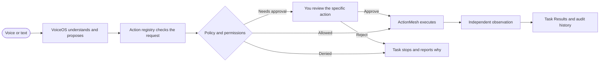

<div align="center">


# ActionMesh + VoiceOS

### Say what you need. See what happened.

VoiceOS is a voice-first desktop assistant. ActionMesh checks each requested action, runs it through one controlled pipeline, and shows the result with evidence.

<br>


[](https://github.com/abhijeetmiskin1/ActionMesh/actions/workflows/ci.yml)

<br>

[Try the demo](#try-it) · [How it works](#one-request-one-pipeline) · [Roadmap](#where-its-going) · [Set up locally](#run-it-locally)

</div>

---

## A desktop assistant with a visible result

Give a short voice or typed command. VoiceOS turns it into a supported task, asks for a missing detail when needed, and hands it to ActionMesh. You can see whether the task is running, finished, blocked, or waiting for your approval.

## Try it

Open **Voice Commands**, press the microphone, and say one of these. You can also type the same request and use **Send & run**.

| Say this | What you should see |
|---|---|
| **“Open Calculator, then is Calculator running?”** | Calculator opens, then its running state is checked independently. |
| **“Open WhatsApp”** | Requests the native app launch through the existing permission flow. WhatsApp must be installed on the Mac. |
| **“Open browser”** | Opens a page in the controlled browser and reports the observed navigation. |
| **“Check the best deal”**, then **“USB-C charger”** | Asks for the product, then opens web search links. Search links are not verified offers. |
| **“Show open issues in abhijeetmiskin1/ActionMesh”** | Looks up public repository issues and returns a source-linked result. |

For continuous conversation, enable **Keep listening after replies**. Then try **“Jarvis, repeat that”** or **“Jarvis, stop listening.”** Check **Voice readiness → Check setup** before a live demo.

## One request, one pipeline



The proposal does not grant itself permission. ActionMesh applies policy, pauses for required approval, and checks the result separately from the action that ran. If it cannot verify the outcome, it says so.

## What works today

<table>
<tr>
<td width="50%">

### Desktop control
Native Mac app launch and status checks, plus a controlled browser path. Actions use the shared permission and verification pipeline.

</td>
<td width="50%">

### Voice and typed commands
Microphone capture, transcription, follow-up questions, and a typed fallback through the same task flow.

</td>
</tr>
<tr>
<td width="50%">

### Task Results
See each step, its state, what blocked it, and the observation used to verify it.

</td>
<td width="50%">

### Connected data
Public GitHub repository and issue lookup are available. Private repository reads need a scoped token.

</td>
</tr>
</table>

### In progress

| Area | Current state |
|---|---|
| Google Drive | Search adapter and fixture coverage exist; live search needs a configured read-only OAuth connection. |
| Shopping research | Finds search links. Offer matching, seller checks, and delivered-price comparison are not yet verified. |
| Image creation | No working image provider is connected in this build. |

## Where it’s going

The goal is a useful everyday assistant that can handle a request from first instruction to a clear, verifiable result. Each stage builds on the same permission and execution path.

<table>
<tr><th>Stage</th><th>Planned direction</th><th>Progress</th></tr>
<tr><td><strong>1 · Reliable desktop tasks</strong></td><td>More dependable speech, app and browser control, natural follow-ups, and clear recovery when something is unavailable.</td><td>In development</td></tr>
<tr><td><strong>2 · Personal work search</strong></td><td>Read-only search across connected GitHub and Google Workspace data, with source links and concise summaries.</td><td>Adapters underway</td></tr>
<tr><td><strong>3 · Multi-step assistance</strong></td><td>Use verified results to choose a bounded next step, while asking when a target is unclear.</td><td>Planned</td></tr>
<tr><td><strong>4 · Research and creation</strong></td><td>Compare real offers and add image creation only when a supported provider can be verified.</td><td>Planned</td></tr>
<tr><td><strong>5 · User-approved actions</strong></td><td>Extend into higher-impact tasks with clear details, per-action approval, and a verifiable receipt.</td><td>Future</td></tr>
</table>

These are project directions, not promises that unfinished integrations already work. See the [roadmap](docs/project/ROADMAP.md) for current detail.

## Run it locally

Requirements: Python 3.11 or newer and Node.js.

```bash
python3 -m venv .venv
.venv/bin/python -m pip install -e '.[dev]'
cd desktop
npm ci
npm start
```

To use speech recognition, configure **Providers → Audio** with a compatible transcription endpoint, model, and credential. Grant only the permissions needed for the commands you want to try. Provider credentials are stored through the operating system’s credential service.

### Run the checks

From the project root:

```bash
.venv/bin/python -m pytest tests -q
.venv/bin/ruff check actionmesh tests scripts
.venv/bin/mypy actionmesh
(cd desktop && npm test)
```

## Explore the project

| | |
|---|---|
| **Project overview** | [Solution pitch](docs/SOLUTION_PITCH.md) · [Project overview](docs/project/PROJECT_OVERVIEW.md) |
| **Design and safeguards** | [System architecture](docs/project/SYSTEM_ARCHITECTURE.md) · [Security model](docs/project/SECURITY_MODEL.md) · [Execution contract](docs/c42-execution-contract.md) |
| **Build and test** | [Development guide](docs/project/DEVELOPMENT_GUIDE.md) · [Integrations](docs/project/INTEGRATIONS.md) · [Testing and acceptance](docs/project/TESTING_AND_ACCEPTANCE.md) |
| **Project details** | [Roadmap](docs/project/ROADMAP.md) · [Changelog](CHANGELOG.md) · [Apache 2.0 license](LICENSE) |

<div align="center">

---

**ActionMesh + VoiceOS** · Built to make desktop assistance observable, permission-aware, and useful.

</div>
