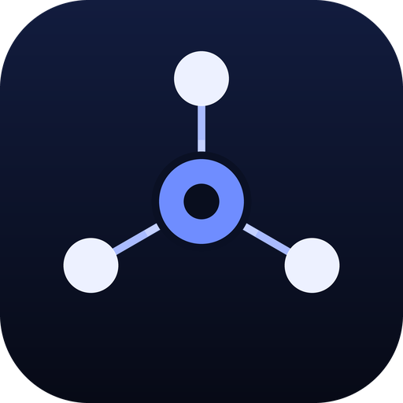
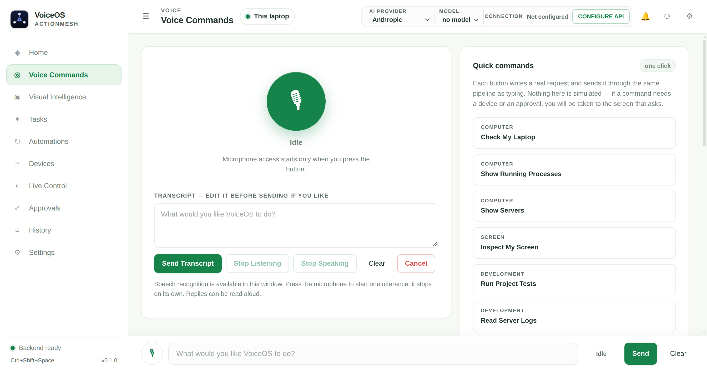
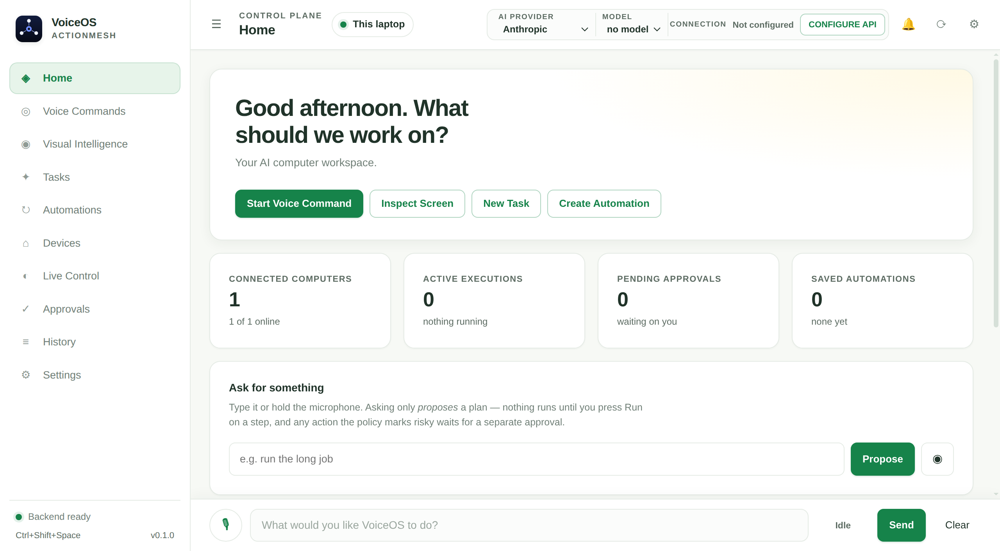
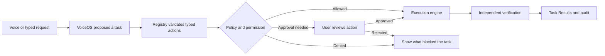

<div align="center">
  
  <h1>ActionMesh + VoiceOS</h1>
  <p><strong>A voice assistant that performs supported tasks and shows what actually happened.</strong></p>
  <p>macOS desktop · Python execution engine · Apache 2.0</p>
</div>

[One-page solution pitch](docs/SOLUTION_PITCH.md) · [How it works](#how-it-works) · [Run locally](#run-locally) · [Project documentation](docs/project/AI_HANDOFF.md)

## Try the demo

In **Voice Commands**, press the microphone and say a command. **Heard** shows the transcript. **Task Results** explains the outcome, with the detailed execution trace available on demand. You can also type the command and press **Send & run**.

| Say | What ActionMesh does |
|---|---|
| “Open Calculator, then is Calculator running?” | Opens the native app and separately checks whether macOS reports it running. |
| “Open browser” | Opens ActionMesh’s controlled browser and verifies navigation. |
| “Check the best deal” → “USB-C charger” | Asks which product, then searches the web and reports the search links it found. |
| “Show open issues in abhijeetmiskin1/ActionMesh” | Reads the public GitHub API and presents the verified count and source. |

Turn on **Keep listening after replies** to try **“Jarvis, repeat that”** and **“Jarvis, stop listening.”** Use **Voice readiness → Check setup** to check microphone access and task permissions before a demo.

## Desktop preview

The images below are real screenshots from earlier desktop builds. The current layout and controls may differ.

| Voice Commands | Desktop workspace |
|---|---|
|  |  |

## How it works



VoiceOS is the interface. ActionMesh owns the execution pipeline. The policy engine checks permissions before a provider runs, consequential actions require per-action approval, and unverified work stays visible as such. See the [execution contract](docs/c42-execution-contract.md).

## Capability status

| Capability | Evidence and boundaries |
|---|---|
| Mac app control, controlled browser, spoken task flow | Packaged Mac rehearsals verified native app launch and status, browser navigation, and transcription with supplied recordings. Physical microphone access was checked separately. |
| GitHub repository and issue lookup | Public reads verified against the live API. Private issues require a repository-scoped token. |
| Google Drive metadata search | Adapter and fixture tests are in place. Live use requires a Drive API OAuth token with metadata read access. |
| Product discovery | Returns search links. Verified seller and delivered-price comparisons and checkout are pending. |
| Image generation | Provider integration pending. |

See [integrations and setup](docs/project/INTEGRATIONS.md) and [testing and acceptance](docs/project/TESTING_AND_ACCEPTANCE.md).

## Run locally

Use Python 3.11 or newer and Node.js. The desktop development build uses the Python environment in the project root.

```bash
python3 -m venv .venv
.venv/bin/python -m pip install -e '.[dev]'
cd desktop
npm ci
npm start
```

For voice recognition, configure **Providers → Audio** with an OpenAI-compatible transcription endpoint, model, and credential. Use **Approvals** to grant the scopes required by your commands. The desktop stores provider credentials using the operating system’s encryption service.

```bash
# From the project root
.venv/bin/python -m pytest tests -q
.venv/bin/ruff check actionmesh tests scripts
.venv/bin/mypy actionmesh
(cd desktop && npm test)
```

[Architecture](docs/project/SYSTEM_ARCHITECTURE.md) · [Security model](docs/project/SECURITY_MODEL.md) · [Roadmap](docs/project/ROADMAP.md) · [Changelog](CHANGELOG.md) · [License](LICENSE)
