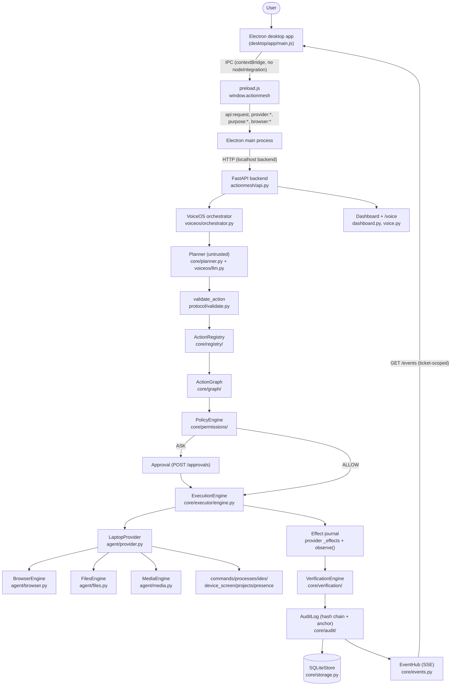
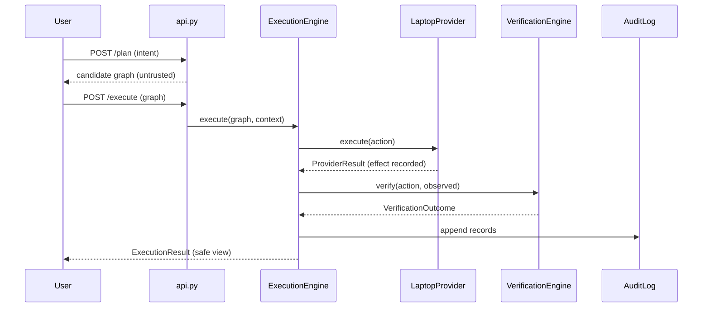
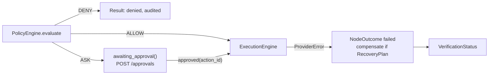
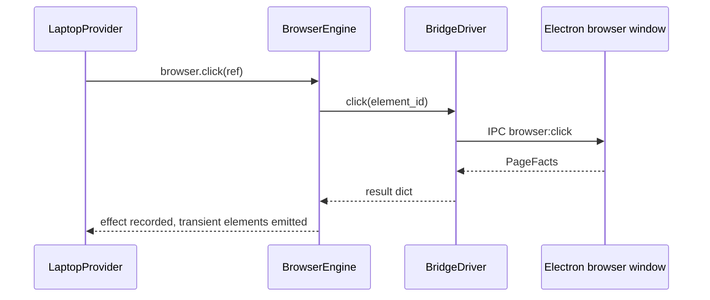

# System Architecture

## High-level diagram (corrected to match source)

## Process boundaries

| Process | What runs there | Communication |
|---|---|---|
| **Electron main** (`desktop/app/main.js`) | Window management, backend process lifecycle, provider bridge, browser window (`browser_window.js`), settings | IPC via `preload.js`; HTTP to backend |
| **Electron renderer** (`desktop/ui/app.js`) | UI only; no Node access (`contextIsolation: true`, `nodeIntegration: false`, `sandbox: true` in `main.js` `webPreferences`) | `window.actionmesh` bridge only |
| **Python backend** (`actionmesh/api.py`, FastAPI) | Registry, policy, executor, verification, audit, VoiceOS | HTTP REST + SSE; spawns/owns the agent |
| **Laptop agent** (`actionmesh/agent/`) | `LaptopProvider` — the *only* place with real OS access | In-process provider; Electron browser window via `browser_ipc.py` / `browser_bridge.py` |
| **Browser session** (Electron `WebContentsView`, partition `actionmesh-web-drive` / `actionmesh-web-pages`) | Untrusted page content | Named IPC commands (`browser:*`), no arbitrary JS execution |

## Communication mechanisms

- **REST/HTTP** — all `/plan`, `/execute`, `/approvals`, `/consents`,
  `/voiceos/*`, `/automations/*` routes in `actionmesh/api.py` (see
  [API_REFERENCE.md](API_REFERENCE.md)).
- **SSE** — `GET /events/stream-ticket` mints a ticket; `GET /events` streams
  `MeshEvent`s. Tickets are actor-scoped (`api.py::_stream_principal`,
  `_record_scope`).
- **IPC** — 42 `ipcMain.handle(...)` channels in `desktop/app/*.js`
  (`api:request`, `provider:*`, `purpose:*`, `browser:*`, `backend:*`,
  `stream:*`, `settings:*`, `window:*`, …), exposed through a single
  `contextBridge.exposeInMainWorld('actionmesh', …)` in `preload.js`.
- **Provider bridge** — `desktop/app/provider_bridge.js` carries provider
  credentials between the renderer (config UI) and the Python desktop
  provider (`voiceos/model_bridge.py`, `DesktopProvider`/`DesktopAnalyst`).
  Credentials never cross into Python logs or audit records.

## Persistence

- **SQLite execution store** — `actionmesh/core/storage.py` `SQLiteStore`:
  `execution_records`, `mesh_events`, `execution_body`, `agent_dispatch`
  (migrated v0→v3 in `_migrate_v0_to_v1/v2_to_v3`).
- **Audit** — `actionmesh/core/audit/sqlite.py` `SqliteAuditBackend`
  (`audit_records`); hash chain in `log.py` (`compute_hash`, `verify`);
  external anchor via `anchor.py` (`FileAuditAnchor`, `verify_anchor`).
- **Identity/pairing/devices** — `core/identity.py` (`SQLiteIdentityStore`),
  `core/pairing.py` (`PairingService`), `core/devices.py`.
- **VoiceOS sessions/automations** — `voiceos/store.py`,
  `automation_store.py`, `automation_scheduler.py`, `automation_run.py`.
- **Safe result views** — `core/executor/serialization.py`
  `safe_result_view` (allowlist strips `stdout`/`stderr`/file bodies from
  events and result payloads).

## Credential storage

`actionmesh/core/credentials.py` and `core/secret.py` (fail-closed: a
truncated key is refused, not regenerated). Provider keys are configured via
the desktop provider bridge, never logged.

## Synchronous vs asynchronous

- **Async:** `ExecutionEngine` (entire engine is asyncio-based: `execute`,
  `resume`, `run_lease_sweeper`, `_watch_cancellation`, browser handlers via
  `ASYNC_ACTIONS` in `LaptopProvider`).
- **Sync:** `FilesEngine` (fd-based, immediate), `PolicyEngine.evaluate`,
  `VerificationEngine.verify`, `AuditLog.append`, registry resolution.
- **Async (Python) / sync (JS):** browser IPC round-trips are async on both
  sides of the bridge.

## Lifecycle diagrams

### 1. Normal execution

### 2–4. Permission request / approval / failure

### 5. Verification (independent)

The provider's `verify()` returns `verified=False` by design. `observe()`
re-reads the world (e.g. `FilesEngine.info`, browser `state()`), then
`VerificationEngine.verify` / `verdicts.decide` produces
`VerificationStatus`. Unconfirmed/`REQUIRES_USER` outcomes are reported as
such — never as success (`docs/c42-execution-contract.md` §0.7).

### 6. Browser execution

Refs are opaque, session-scoped, monotonically increasing ids minted by the
snapshot — never coordinates, never model-invented selectors.

### 7. File operation

`device.files.*` → `FilesEngine` (`agent/files.py`): `_resolve` via
`Workspace` (path traversal + symlink safe, fd-pinned `_open_fd`) →
operation → effect recorded → `observe()` re-reads via `info()`.

### 8. Media operation

`media.*` → `MediaEngine` (`agent/media.py`): `MprisMediaDriver` over the
session D-Bus (`org.mpris.MediaPlayer2`) or `FakeMediaDriver` in tests.
**Not live-verified against a real player.**

### 9. Voice command

User speaks → browser speech recognition (renderer, `desktop/ui/voice.js`) →
transcript (editable; text fallback) → `POST /voiceos/messages` → task
template match (`voiceos/tasks.py: match_template`) or LLM plan
(`voiceos/llm.py`) → `Orchestrator.advance` runs each step as an ordinary
ActionMesh graph through the same policy/approval/executor path → spoken
feedback via renderer TTS.

## Startup and shutdown

- **Backend:** `python -m actionmesh.cli serve` (`cli.py`) → FastAPI app
  in `api.py`; `reconcile_interrupted()` and `sweep_lapsed_leases()` on
  startup recover executions left non-terminal by a crash (durable
  execution, C32–C35).
- **Desktop:** `desktop/scripts/start.js` starts Electron; `main.js`
  spawns/supervises the Python backend (`backend:start/stop/restart` IPC),
  which can be restarted from the UI.
- **Cancellation:** `POST /executions/{id}/cancel` → `ExecutionEngine.cancel`
  / `request_cancel` → `_watch_cancellation` task; cross-process via
  `mark_cancel_requested` in the store.

## Error propagation

`ProviderError(message, FailureKind)` (`providers/base.py`) per node →
`NodeOutcome` → `ExecutionResult`. Confinement refusals
(`AgentError`/`OSError`) are wrapped as `FailureKind.AUTHORIZATION`;
missing paths as `INVALID_INPUT` (`agent/files.py::_classify`). Compensation
via `RecoveryPlanner` / `CompensationRunner` (`core/verification/recovery.py`).
